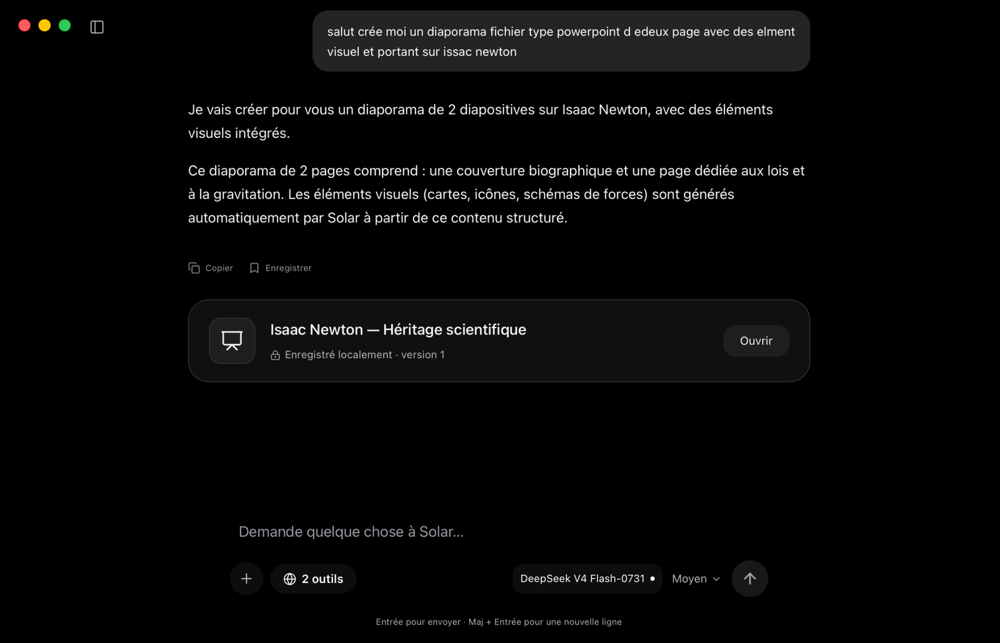
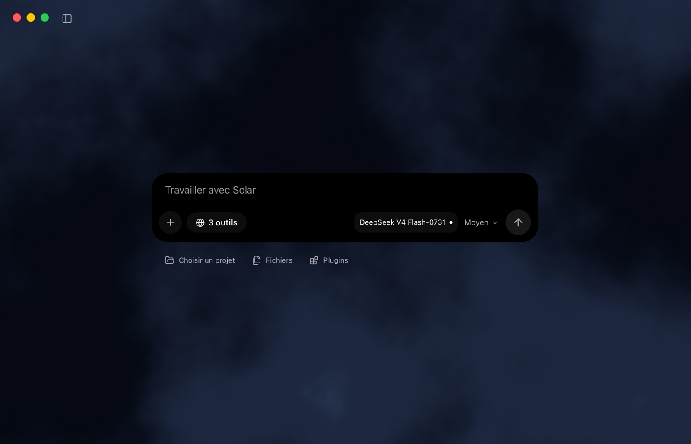
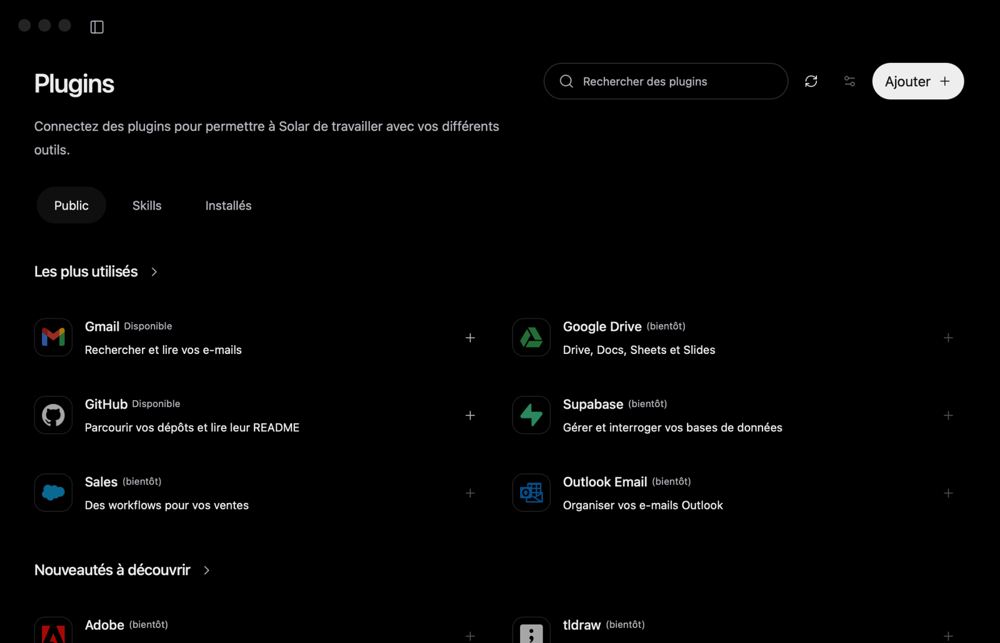
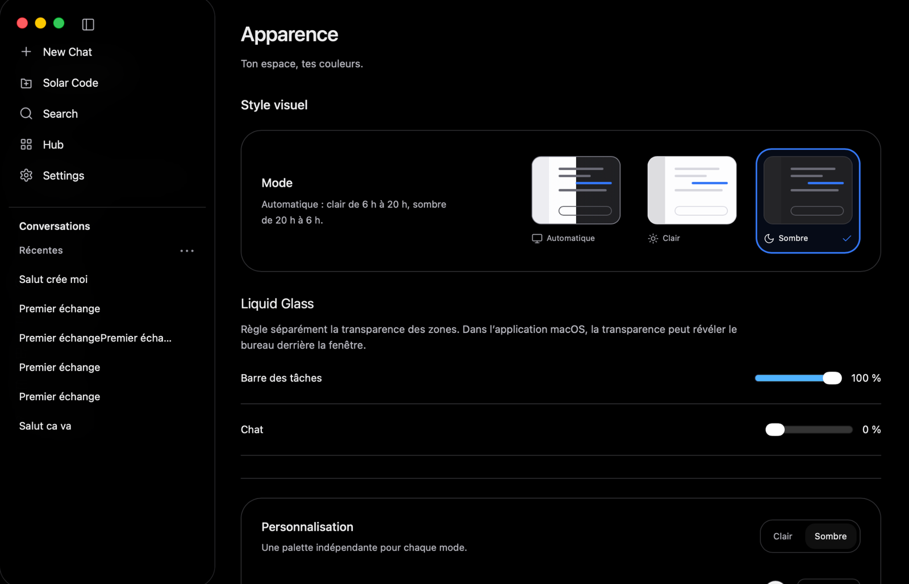
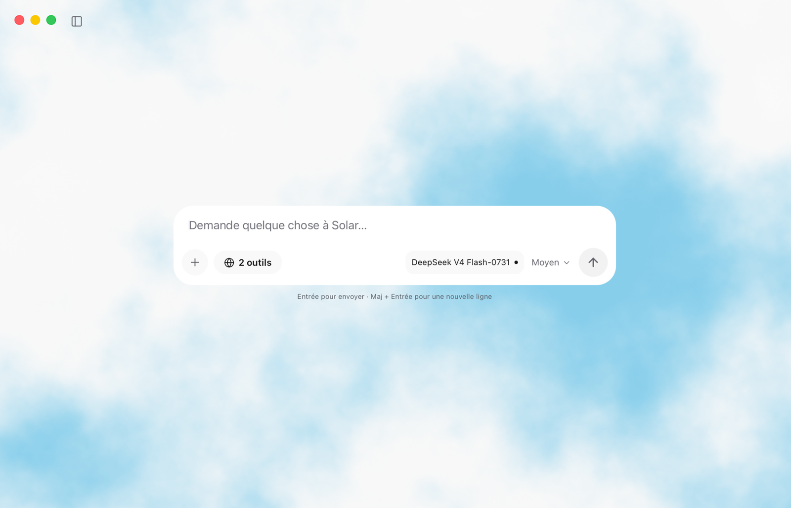

<div align="center">


# Solar

**A beautiful, local-first AI workspace for macOS.**

Chat with your models. Work with your files. Create more, with less clutter.

<p>
  <a href="https://github.com/j4mesbst/Solar/releases/latest"></a>
  <a href="https://github.com/j4mesbst/Solar/stargazers"></a>
</p>

<p>
  
  
  
  
  
</p>

[Features](#features) · [Screenshots](#screenshots) · [Installation](#installation) · [Run locally](#run-locally) · [Contributing](#contributing)

</div>

---

## Meet Solar

Solar is a macOS desktop application that brings AI chat, project-aware assistance, and file creation into one carefully designed workspace. Use **local Ollama models**, connect supported cloud providers, or switch between them as your task changes.

Solar puts a clean interface first, without hiding your control over models, files, tools, or privacy.

<p align="center">
  
</p>

## Features

The features below are implemented in the current development build. Availability of provider services and native macOS behavior still depends on your configuration and platform.

| Feature | Availability |
| :--- | :--- |
| **Chat & Work** | Available. Switch between conversations and a project workspace that reviews proposed file changes before applying them. |
| **Local and cloud models** | Available when configured: Ollama, OpenAI-compatible providers, Anthropic, and GonkaRouter. |
| **Artifacts** | Available: create, preview, edit, and export presentations, documents, spreadsheets, code, and diagrams. |
| **Controls** | Available: model and effort selection, conversation search, drafts, and local performance settings. |
| **Web search** | Available as an opt-in feature; engines depend on configuration and service availability. |
| **Appearance** | Available: light/dark themes, custom appearance settings, and adjustable transparency. |
| **GitHub & Gmail** | Available with user-provided credentials and required configuration, for read-only repository README and email access. |
| **Personal extensions & skills** | Available: HTTPS shortcuts and reusable Markdown instructions. Shortcuts do not connect to service APIs. |

### In development

- The first official macOS release; no V1 release or official DMG has been published yet.
- Further native macOS and live-provider validation.
- Additional public integrations and broader cross-device workflows. Some catalog entries are marked Coming soon and are not functional.

### Chat with the models you choose

Solar supports Ollama for local inference and configurable cloud providers. Discover locally installed Ollama models and select the model you want. Response effort controls the instruction and output budget; actual reasoning capabilities and speed depend on the provider, model, and hardware.

**Local-first does not mean everything runs offline:** remote providers, optional web search, online accounts, and connected services require network access. A local Ollama setup can be used without a cloud model subscription.

### Work on real projects, with review built in

Work mode can inspect files you **explicitly select**, generate proposed changes, and show a **before/after review** before applying them. Where supported, you can accept, reject, or undo changes with safeguards against overwriting later edits.

Solar does **not** automatically execute generated code or terminal commands. Cloud models only receive selected project context after your authorization.

### Make more than chat messages

Ask Solar to produce structured artifacts such as:

- **Presentations** — export to PowerPoint (`.pptx`).
- **Documents** — export to PDF or Word (`.pdf`, `.docx`).
- **Tables** — export to CSV or Excel (`.csv`, `.xlsx`).
- **Code & diagrams** — export source files or Mermaid diagrams (`.svg`, `.mmd`).

Artifact creation depends on a compatible model response. Solar validates the returned structure rather than pretending an incomplete file was created.

### Search, integrations & skills

Solar offers optional web search and a growing extensions interface. **GitHub README access** and **Gmail message search/reading** are supported with user-provided credentials and appropriate configuration; they do not grant Solar permission to push code or send email. Custom HTTPS shortcuts are bookmarks, **not API integrations**.

Some integrations in the directory are marked **Coming soon** and are not yet functional. You can also import reusable Markdown instructions as skills.

## Screenshots

<p align="center"><strong>Stay focused in Work mode</strong></p>
<p align="center"></p>

<table>
  <tr>
    <td width="50%" align="center"><strong>Extensions & plugins</strong></td>
    <td width="50%" align="center"><strong>Make Solar yours</strong></td>
  </tr>
  <tr>
    <td></td>
    <td></td>
  </tr>
</table>

<p align="center"><strong>Light mode, a little lighter</strong></p>
<p align="center"></p>

## Installation

> **No official release is published yet.** The [latest release page](https://github.com/j4mesbst/Solar/releases/latest) currently has no published Solar release, so there is no official DMG to download. The development version is `0.1.0`; this does not mean Solar V1 has shipped.

When a release is published:

1. Visit **[GitHub Releases](https://github.com/j4mesbst/Solar/releases/latest)** and select the latest published macOS release.
2. Download the `.dmg` appropriate for your Mac's processor architecture.
3. Open the DMG and drag **Solar.app** into **Applications**.
4. Launch Solar, then configure a local or remote model provider from the initial setup.

**macOS security note:** No official DMG is currently published, and no release signing or notarization status can be verified. Locally built DMGs are not automatically signed or notarized and may trigger a Gatekeeper warning. Check the status of any future release before installing it.

### Ollama (optional)

To use a local model, install [Ollama](https://ollama.com/), start the Ollama service, and select a model in Solar. Solar can detect an existing Ollama installation and guide you through model setup. Local inference speed and supported models depend on your Mac's hardware.

For remote providers, you will need the corresponding endpoint and credentials. Solar does not include free API credits.

## Run locally

### Requirements

- macOS and the **Xcode Command Line Tools** for native development.
- **Node.js 24** and npm (the version used by CI).
- **Rust** stable toolchain for the native Tauri app.
- Ollama only if you want to run a local model.

```bash
# Clone the project
git clone https://github.com/j4mesbst/Solar.git
cd Solar

# Install dependencies
npm ci

# Start the native macOS app
npm run tauri dev
```

For a browser-only development preview:

```bash
npm run dev
```

Open **http://127.0.0.1:1420**. Some native filesystem, Keychain, and integration behavior differs from the browser preview.

### Build a macOS DMG

On a correctly configured macOS development machine:

```bash
npm run tauri build -- --bundles dmg
```

The output is generally in `src-tauri/target/release/bundle/dmg/`. A locally built DMG is **not automatically signed or notarized**. For public distribution, validate the actual packaged app and the installation process on a clean Mac.

### Development checks

```bash
npm run test:providers
npm run test:chat
npm run test:features
npm run test:evolution
npm run build
```

Other contract and browser UI suites are available in `package.json`. For implementation notes and known limitations, see [PROGRESS.md](PROGRESS.md) and [ROADMAP.md](ROADMAP.md).

## Privacy & safety

Solar is designed around explicit user control, but its privacy properties depend on the features you enable:

- **Local conversation history:** Chat data and drafts are stored locally; account sign-in does not currently synchronize your history between devices.
- **Credentials:** The native application uses macOS Keychain for supported secrets. Avoid sharing credentials, tokens, or private project files in GitHub issues.
- **Cloud providers:** Messages and intentionally selected attachments or project files are sent to the configured provider when you make a request.
- **Work actions:** File changes require review and authorization; there is no automatic code execution.
- **Optional search & plugins:** External services receive information needed for explicitly enabled requests. Review each service's policies and permissions.

See [account and plugin configuration](docs/ACCOUNTS_AND_PLUGINS.md) for supported capabilities and limitations.

## Roadmap

Solar is actively being developed. The roadmap covers first-release preparation, native macOS and live-provider validation, additional integrations, and larger-project workflows. For engineering details, read the [roadmap](ROADMAP.md) and [implementation notes](PROGRESS.md).

## Contributing

Feedback, bug reports, and focused pull requests are welcome.

1. [Open an issue](https://github.com/j4mesbst/Solar/issues) to describe a bug or propose an improvement.
2. For code changes, fork the repository and create a dedicated branch.
3. Run the relevant checks, then open a pull request explaining the change and how it was tested.

Please do not include secrets, personal data, or private files in issue reports.

## License

Solar is released under the [MIT License](LICENSE). Third-party dependencies and included resources may have separate copyright and license terms; their notices remain applicable. See [plugin icon attributions](public/plugin-icons/LICENSE.txt).

---

<div align="center">

**Solar — a calmer way to work with AI.**

Made with care for macOS. Built with [Tauri](https://tauri.app/), [React](https://react.dev/), and [TypeScript](https://www.typescriptlang.org/).

[Back to top](#solar) · [Report an issue](https://github.com/j4mesbst/Solar/issues) · [See releases](https://github.com/j4mesbst/Solar/releases)

</div>
