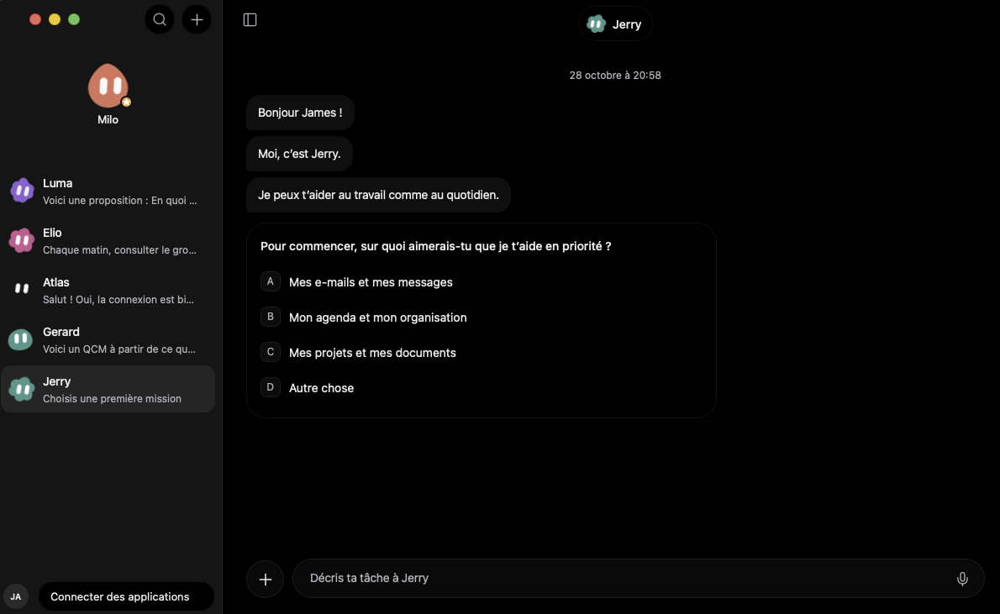
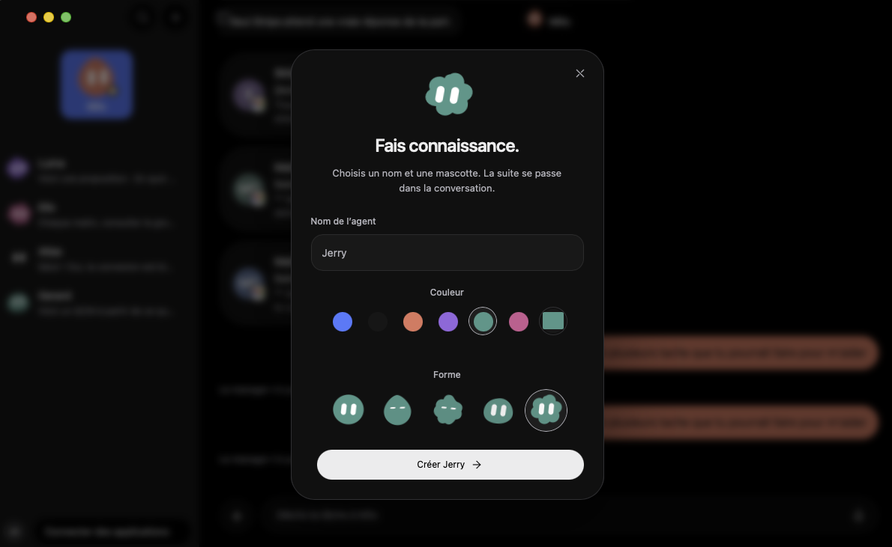
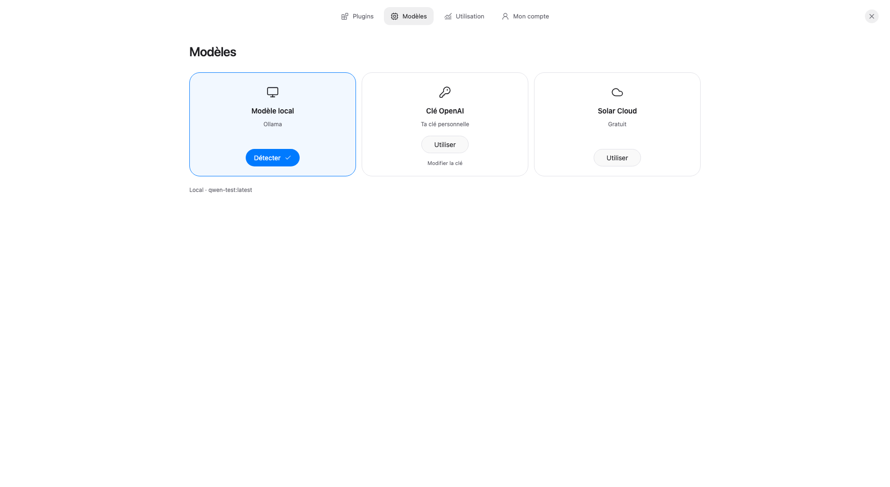
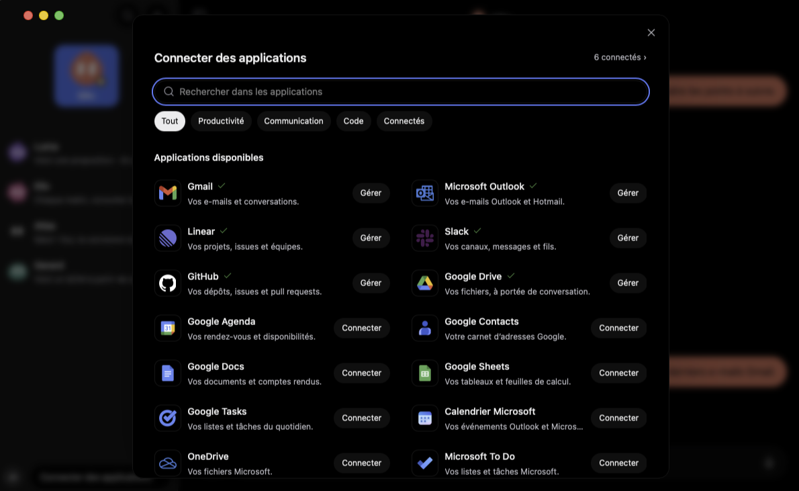

<div align="center">


# Solar 0.15.1

**Votre équipe d’agents IA, sur macOS et Windows.**

Des conversations courtes, des agents personnalisables et le modèle de votre choix.

[](https://github.com/j4mesbst/Solar/releases/download/v0.15.1/Solar-0.15.1-macOS-arm64.dmg)

[](https://github.com/j4mesbst/Solar/releases/download/v0.15.1/Solar-0.15.1-Windows-x64-setup.exe)

[Notes de version](https://github.com/j4mesbst/Solar/releases/tag/v0.15.1) · [Signaler un problème](https://github.com/j4mesbst/Solar/issues) · [Licence MIT](LICENSE)

</div>

## Découvrir Solar

[](https://github.com/j4mesbst/Solar/releases/download/v0.13.4/Solar-demo.mp4)

**[Voir la démonstration vidéo](https://github.com/j4mesbst/Solar/releases/download/v0.13.4/Solar-demo.mp4)**

## Solar aujourd’hui

Solar est une application open source construite avec Tauri, React et TypeScript. Créez vos agents, donnez-leur une mission et échangez avec eux dans une messagerie native. Chaque agent garde son identité, sa conversation et ses autorisations.




- **Une équipe à votre image.** Cinq formes animées, couleur personnalisable et messages assortis. Déplacez un agent en haut de la barre latérale pour en faire un manager, ou réordonnez-le par glisser-déposer. Le clic droit permet de le supprimer de l’équipe ; Annuler le restaure. Son historique est conservé et ses routines restent désactivées après restauration.
- **Une conversation à la fois.** Réponses en bulles successives, choix multiples quand ils sont utiles, brouillons et pièces jointes. Le statut d’un connecteur apparaît uniquement pendant une opération réelle. Après une absence prolongée, Solar peut proposer de reprendre une demande existante, sans lancer de requête avant votre choix.
- **Des autorisations explicites.** Lecture seule, accès standard ou accès complet, choisis pour chaque agent. Le rôle d’un agent ne lui accorde pas de permissions supplémentaires. Les accès dépendent aussi du compte connecté et de ses autorisations.
- **Une bibliothèque simple.** Ajoutez un dossier pour retrouver son nom et sa liste de fichiers dans la bibliothèque de l’agent. L’ajout n’envoie pas automatiquement son contenu à un modèle et ne lui accorde pas de droit d’écriture.
- **Votre apparence.** Modes clair, sombre et personnalisé, typographie native et respect du mouvement réduit.

## Trois façons de choisir un modèle



| Choix | Fonctionnement |
| --- | --- |
| **Modèle local** | Lancez [Ollama](https://ollama.com), installez un modèle, puis cliquez sur **Détecter**. Solar sélectionne un modèle installé. Aucun abonnement cloud n’est nécessaire pour l’inférence locale. |
| **Clé OpenAI** | Entrez votre clé personnelle dans Solar. Elle reste dans le stockage sécurisé du système (Trousseau macOS ou Gestionnaire d’identifiants Windows) ; les requêtes sont facturées par OpenAI selon votre compte. Solar vérifie le catalogue accessible avant de sélectionner un modèle compatible. |
| **Solar Cloud** | Option gratuite lorsque le service est configuré sur votre compte. Cette version open source ne distribue aucune clé privée ni accès cloud universel ; la disponibilité dépend du fournisseur et de ses limites. |

Solar utilise le modèle sélectionné, sans basculer silencieusement vers un autre fournisseur. Un modèle local peut avoir moins de capacités d’outils ou de vision qu’un modèle cloud.

## Applications connectées




La galerie permet de connecter les services dont les adaptateurs sont implémentés, notamment Gmail, Google Agenda et GitHub selon la configuration de l’application et de votre compte. Les icônes et états de connexion reflètent les services réels. Certaines entrées nécessitent votre propre configuration OAuth, une clé ou un serveur MCP ; leur présence dans la galerie ne signifie pas qu’elles sont déjà utilisables.

Les clés personnelles sont conservées dans le Trousseau macOS ou le Gestionnaire d’identifiants Windows. Les lectures concurrentes du même secret sont regroupées et mises en cache en mémoire pendant la session. Le système peut demander une autorisation initiale ; Solar ne désactive pas les protections du système.

## Télécharger et installer

**[Télécharger Solar 0.15.1 pour macOS — Apple Silicon (.dmg)](https://github.com/j4mesbst/Solar/releases/download/v0.15.1/Solar-0.15.1-macOS-arm64.dmg)**

**[Download Solar 0.15.1 for Windows — x64 (.exe)](https://github.com/j4mesbst/Solar/releases/download/v0.15.1/Solar-0.15.1-Windows-x64-setup.exe)**

1. Sur Mac, ouvrez le DMG et glissez **Solar.app** dans **Applications**. Sur Windows, lancez le programme **setup.exe** et suivez l’installation pour votre compte.
2. Lancez Solar et choisissez un modèle dans **Modèles**.
3. Créez votre premier agent. Les connexions de services sont facultatives.

Le DMG est destiné aux Mac **Apple Silicon (arm64)** sous **macOS 11 ou version ultérieure**. Il est signé localement (ad hoc), sans notarisation Apple : macOS peut afficher un avertissement de provenance. Une version Intel précompilée n’est pas fournie. Les sommes SHA-256 sont jointes à la release.

Le programme Windows est destiné à **Windows 10/11 x64**. Il installe WebView2 si nécessaire, ce qui demande une connexion Internet. Il n’est pas signé avec un certificat éditeur Windows ; SmartScreen peut afficher un avertissement de provenance. Une compilation ARM64 Windows native n’est pas fournie. La dictée utilise le micro autorisé par Windows et un modèle Whisper local téléchargé explicitement ; son confort dépend du matériel. Les connecteurs demandent leurs propres autorisations et une configuration disponible.

## Nouveautés de la 0.15.1

- Pied de barre latérale : initiales/photo et capsule Connecter avec jusqu’à trois logos de connexions enregistrées.
- Marges minimales de 20 px autour des contrôles périphériques.
- Champ de message et bouton + réduits de 20 % en hauteur ; saisie multiligne conservée.
- Animation de lancement sur fond noir, logo noir et reflets de verre conservés.
- Icône de mise à jour en nuage pour les prochaines versions.

Depuis la 0.15.0, reviens sur la fenêtre Solar pour vérifier la publication : son bouton bleu actuel apparaît quand cette version et son empreinte sont disponibles. Clique dessus pour télécharger, vérifier et installer la version, puis rouvrir Solar. La nouvelle icône nuage apparaît à partir de la 0.15.1. Aucun clic ni remplacement de l’application de James n’a été effectué pour ce test.

## Fonctions introduites en 0.15.0

- Connexion OAuth lancée directement au clic, avec annulation et retour vers Solar.
- Page d’autorisation sobre ; succès après vérification et sauvegarde du compte.
- Menu du profil en lignes, prénom et icônes Compte/Plugins animées au survol.
- Animation de verre du logo à l’ouverture, sur fond blanc ; mouvement réduit respecté.
- Bouton MAJ bleu affiché uniquement pour une version stable plus récente avec installateur et empreinte SHA-256. Téléchargement, vérification puis installation et réouverture sur Mac/Windows. Termine les tâches avant de mettre à jour.
- Suppression du dégradé qui coupait les messages en haut du chat.

Depuis la 0.14 ou une version antérieure, installe manuellement une version 0.15 ou ultérieure une première fois pour obtenir le bouton MAJ. Sur Mac, glisse Solar dans Applications ; l’app doit avoir le droit de s’y remplacer. Les clés et conversations restent dans le stockage existant. Les fichiers proviennent du dépôt GitHub Solar en HTTPS, avec vérification SHA-256 ; cela ne constitue pas une notarisation Apple ni un certificat éditeur Windows.

## Finitions de la 0.13.4

- QCM demandés ou spontanés plus robustes, avec trois propositions adaptées au rôle.
- Deux bulles de réponse privilégiées, trois au maximum ; code, tableaux et cartes conservés.
- Demandes d’aide au manager traitées comme une conversation avant toute délégation.
- Statuts d’outils lisibles, sans balises de commande ; annulations reformulées en français.
- Zone supérieure pour déplacer la fenêtre et boutons macOS repositionnés.
- Thèmes clair et sombre affinés, sélection du manager grise et palettes personnalisées conservées.

Les captures et la vidéo ci-dessus ont été fournies par James et montrent la session précédant les dernières finitions de la 0.13.4.

## Limites actuelles

- **Ordinateur : bientôt.** L’onglet annonce le navigateur Solar ; il ne promet ni machine virtuelle ni contrôle autonome du Mac.
- L’exécution d’agents dépend du modèle, des intégrations configurées et de leurs limites. Les résultats importants doivent être vérifiés.
- Une routine nécessite une application en cours d’exécution ; Quitter et la veille interrompent le travail. Le code du moteur et des routines reste présent, même si leurs anciens formulaires ne sont plus affichés dans le panneau Détails.
- Les conversations, brouillons et paramètres sont stockés localement. Un compte en ligne ne constitue pas une sauvegarde ou synchronisation complète.
- « Local » concerne l’inférence : un connecteur, une recherche web ou un modèle cloud utilise le réseau. Les services OAuth et Solar Cloud nécessitent une configuration côté opérateur ; aucun secret de déploiement n’est fourni dans le dépôt.

## Développer

Prérequis : Node.js 24, npm 10.9.4, Rust stable, Xcode Command Line Tools sur macOS ou Visual Studio Build Tools (C++) sur Windows et les [prérequis Tauri](https://v2.tauri.app/start/prerequisites/).

```sh
git clone https://github.com/j4mesbst/Solar.git
cd Solar
npm install --global npm@10.9.4
npm ci
npm run tauri -- dev
```

L’interface seule peut s’ouvrir avec `npm run dev`. Les commandes natives, le Trousseau et les sélecteurs de fichiers doivent être vérifiés dans l’application native de chaque système.

Copiez `.env.example` vers `.env.local` seulement si vous configurez un service optionnel. Les identifiants publics OAuth et Supabase sont distincts des secrets serveur. N’ajoutez jamais de clé privée à une variable `VITE_` ou à Git.

```sh
npm run build
node scripts/messenger-contract.test.mjs
npm run test:chat
npm run test:agent:durable
cargo test --locked --manifest-path src-tauri/Cargo.toml
```

Pour compiler un bundle macOS :

```sh
npm run tauri -- build --bundles app,dmg
```

Pour compiler l’installateur Windows sur Windows :

```sh
npm run tauri -- build --target x86_64-pc-windows-msvc --bundles nsis
```

Le workflow `windows-package.yml` contrôle aussi les secrets jetables, les verrous, l’installation et l’apparition d’une vraie fenêtre. Les tests automatisés n’attestent pas une connexion personnelle ni la qualité d’un microphone physique.

## Contribuer

Les problèmes reproductibles, captures sans données privées et pull requests sont les bienvenus. Précisez votre système, architecture, version de Solar et modèle utilisé. N’incluez pas de conversation privée, jeton, clé API ou fichier personnel dans un rapport.

Solar est distribué sous [licence MIT](LICENSE). Les marques des services connectés appartiennent à leurs propriétaires.
