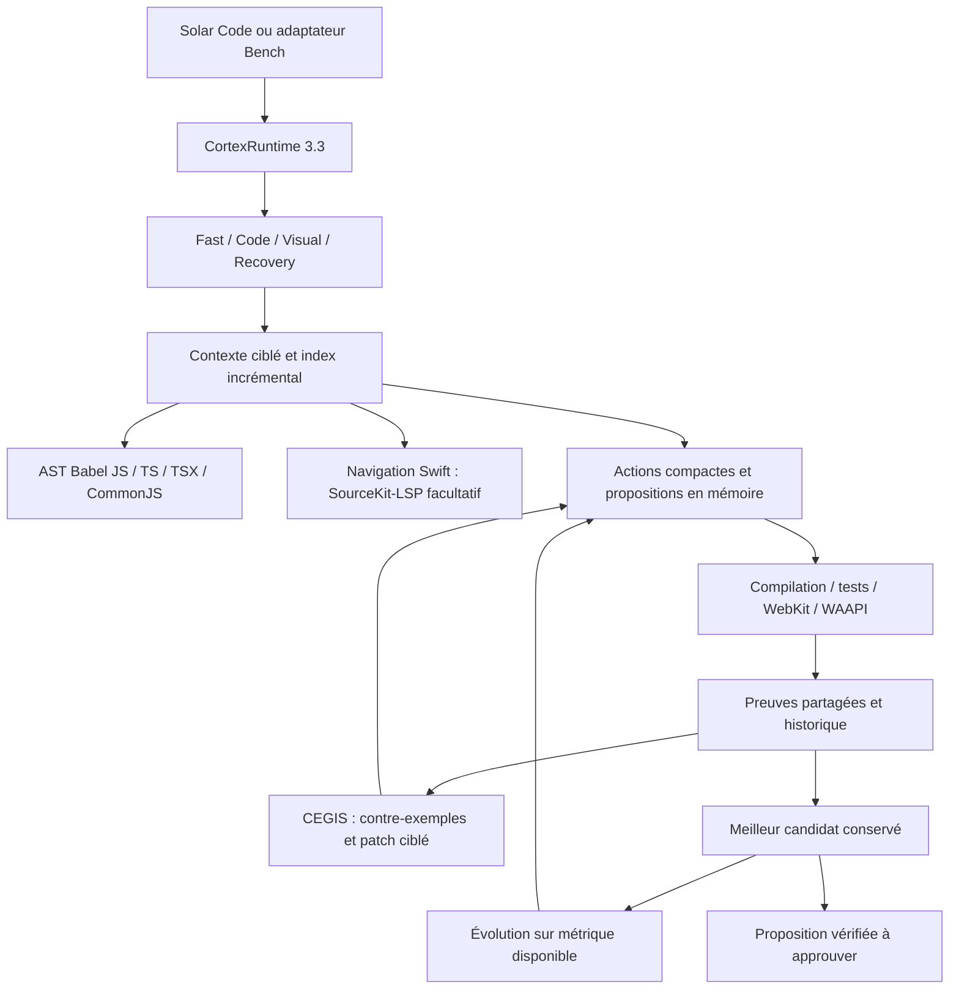

# Solar Cortex V3.3

V3.3 enrichit le runtime déjà appelé par Solar Code. Il utilise le modèle Ollama sélectionné ; `ornith-1.5:9b` demeure la référence du catalogue et du CLI. Aucun benchmark avec un LLM n’a été lancé pendant cette implémentation.

## Actions et sorties

Le catalogue réutilise les actions existantes et ajoute :

- `searchSymbol(query)` et `readSymbol(symbolId)` : recherche réelle et lecture avec empreinte.
- `readFileRange(path,start,end)` : lignes numérotées et empreinte courante, 200 lignes maximum.
- `replaceRange(path,start,end,content,sourceHash)` : refus si la source a changé.
- `applyPatch(path,oldText,newText)` : patch textuel avec contexte unique, sans shell.
- `patchStyle(path,selector,changes,sourceHash)` : une règle CSS unique, propriétés bornées ; ambiguïtés et valeurs actives refusées.
- `runBuild()` et `runTests()` : alias des contrôles autorisés.
- `inspectUI(path,viewport)` et `inspectMotion(path,timeline,selector?)` : inspection réelle ; un sélecteur de motion déclenche un clic avant les mesures.

Les schémas discriminés, protections des chemins et propositions avant approbation restent en vigueur. Un tour compact propose au maximum deux actions. Seuls les objets d’actions complets peuvent être récupérés avant une troncature ; un objet partiel n’est jamais exécuté. Le suffixe peut être demandé au tour suivant. Les champs inattendus sont refusés.

## Preuves, CEGIS et candidats

Les vérifications exposent identité/version, statut, contrainte obligatoire, métriques disponibles, diagnostics, contre-exemples observés, fichiers/preuves associés et timestamp. Preuves et tentatives sont bornées dans le checkpoint.

La réparation reçoit les échecs observés et le code courant. Si elle fait perdre un contrôle obligatoire acquis, la régression est rejetée et la meilleure proposition restaurée. Les tests existants et chemins protégés ne peuvent pas être modifiés pour faire passer la tâche. Les tests proposés par le modèle ne deviennent pas des références.

L’évolution utilise les mêmes contrôles et une métrique mesurable, via `request.evolution`. Une reproduction de référence en Deep/Ultra peut employer l’écart image comme objectif secondaire. Il ne devient pas une note esthétique ou une preuve fonctionnelle. Une recherche sans progrès conserve la meilleure version vérifiée.

## Contexte et navigation

Babel, déjà installé, fournit un véritable AST JS/TS/TSX et CommonJS, chargé à la demande. Symboles, empreintes, imports et relations alimentent les outils et la RepoMap. Les caches sont invalidés par contenu et bornés.

SourceKit-LSP enrichit facultativement la navigation Swift sur une copie des propositions. Dialogue JSON-RPC réel, annulation et délai technique de 5 secondes ; les résultats servent aux réparations. La compilation reste l’autorité. L’absence du serveur ne bloque pas une proposition compilée.

Limites : Tree-sitter n’est pas ajouté. Swift/Rust conservent un extracteur structurel de repli. Le LSP Swift couvre `documentSymbol`, pas les renommages sûrs, toutes les références ou un système de types inter-projets. LSP Rust/TypeScript et base vectorielle non ajoutés. Aucune propriété de test universelle n’est inventée à partir du texte libre.

## Visuel et motion

Le helper WebKit accepte viewports bornés, clics/saisies reproductibles et instants de mesure. CSS/WAAPI est mis en pause puis échantillonné ; géométrie, transformations, opacité et flou proviennent des styles calculés. Les interactions ne dépendent plus du `requestAnimationFrame` susceptible d’être suspendu hors écran.

Vite est servi depuis le build avec scripts, CSS et ressources sur une adresse loopback éphémère. Une CSP interdit le réseau externe. Solar et Bench transmettent le rapport réel au moteur de preuves. Les corrections CSS seules peuvent aussi être examinées avec le document et ses assets.

Les contraintes numériques se passent par `visualConstraints`. Une largeur de sidebar explicitement chiffrée peut aussi devenir une contrainte mesurée. Les captures HTML et Vite peuvent être examinées par le modèle sélectionné si son backend déclare la vision. Les conseils alimentent les réparations comme observations indicatives ; une erreur de vision complémentaire n’annule pas les contrôles indépendants.

Limites : mouvement réduit émulé et identifié comme tel, horloges JS arbitraires non virtualisées. Comparaison bitmap globale, sans segmentation générale fiable des régions d’une référence inconnue. Les géométries d’une image sans DOM ne sont pas inventées. Une capture sans erreur ne prouve pas un design premium.

## Stratégies, ressources et ablations

Fast évite une planification séparée pour les petites modifications ; Visual conserve First Working Artifact. Un patch périmé ou un format invalide déclenche Recovery avec la source courante. Stagnation et annulation restent explicites. Le build et la vision ne sont plus répétés en mode Fast sur la même proposition finale.

Aucun nouveau plafond global de temps, étapes ou générations en production. Watchdogs par appel, protections, limites explicitement demandées et stagnation sont conservés. Aucune seconde instance principale de LLM.

`atomicActions`, `semantic`, `cegis`, `visualSolver`, `evolution`, `adaptive` se désactivent dans `CortexRequest.features`. Solar transmet le réglage persistant facultatif `AppSettings.cortexFeatures`, sans ajouter de contrôles visuels. Bench propose `--disable cegis,visual-solver,evolution,semantic,atomic-actions,adaptive` pour les futures ablations, non exécutées ici.

## Solar Bench

Contrat conservé : `contractVersion:1`, `version:3.3.0`. La racine du dépôt vient du module, quel que soit le dossier du Terminal. Swift/Node renvoient les contrôles attendus `build`/`tests`. Le plafond historique de 18 étapes de l’adaptateur est retiré ; les délais du benchmark restent séparés.

Le registre V2 définit 25 exercices fixes, cinq par domaine. Les identifiants historiques restent disponibles ; les validateurs renforcés portent la version 2. Les nouvelles tâches couvrent groupement/tri/moyenne Swift, refactoring multi-fichiers, onglets/dialogue/chat, grille/toolbar/mobile, interaction et cascade.

Les snapshots du moniteur sont sérialisés et atomiques ; les ticks conservent les compteurs. Les checkpoints, preuves, générations/réparations et métriques disponibles sont conservés. Le RSS rapporté est celui du CLI ; `size_vram` est la taille chargée annoncée par Ollama, pas la consommation totale du Mac. Une reprise incompatible est refusée.

Les 25 exercices sont définis et exécutables. Leur réussite avec Ornith V3.3 et le gain sur V3.2 restent **non mesurés** jusqu’à la campagne lancée par l’utilisateur.

Voir [le rapport de validation](docs/SOLAR_CORTEX_V3_3_VALIDATION.md) et [les commandes Bench](SOLAR_BENCH.md).
