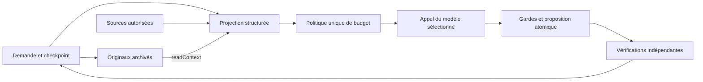

# Stabilisation avant V5 — architecture du contexte

16 octobre 2026. Travail local sur `codex/cortex-v4.1-stabilization`, à partir de V4.1 non commitée. Le runtime reste 4.1.0 ; le paquet de contexte possède son propre contrat `version:1`. Aucune nouvelle couche d’agent, aucun provider ajouté.

## Responsabilités

| Catégorie | Représentation et emplacement | Règle |
| --- | --- | --- |
| A. Fondations | `runtime.ts` / `prompt.ts` : système et protocole stables ; schéma réel par opération | Sources, mémoire, diagnostics et consignes de packs restent hors du préfixe système. Le schéma détermine les outils du tour ; les gardes d’exécution restent indépendantes du modèle. |
| B. Objectif | `ContextPacket.objective`, `requirements`, `task.userRequirements` | Demande entière, citations utilisateur liées à leurs IDs, doublons exacts supprimés. Pas de synthèse LLM ni de suppression supposée d’une obligation. La demande actuelle prévaut lors d’un changement explicite. |
| C. État | `taskContextPacket` : phase, plan/nœud actif, fichiers/hash, contrôles/provenance, erreurs/références, actions récentes | Données structurées ; les résumés de résultat ne remplacent pas les preuves originales. Les comptes de contrôles restent complets ; jusqu’à 12 références de contrôle sont projetées dans le contexte. |
| D. Projet | `prepareContext` → sélection lexicale/symboles/dépendances → extraits identifiés | Les sources préparées priment sur le disque initial. Relecture par `readFileRange` / `readSymbol`, source complète si nécessaire. Un extrait et sa coupure sont signalés. |
| E. Histoire | Archive privée du checkpoint et mémoire versionnée | Une ancienne observation est historique si ses sources changent. Une expérience passée n’est jamais un oracle actuel. |

`budget.ts` est la politique commune. `sourceSelectionBudget` guide les lectures initiales ; il ne constitue plus un second budget final. `fitModelPayload` mesure le texte sérialisé système/messages/schéma/outils, y compris l’échappement JSON, réserve la sortie, 900 tokens techniques et 1024 estimés par image. Le runtime effectue ce contrôle aussi pour les adaptateurs simulés ; le backend refait le même calcul avec son enveloppe d’outils effective et transmet la sélection finale au journal. Ces deux contrôles utilisent les mêmes règles. Le nombre exact de tokens et le coût des images restent estimés, pas mesurés par un tokenizer.

L’entrée React ne calcule plus `budgetConversation` pour Cortex : ce gestionnaire legacy et son résumé de décisions assistant restent réservés au chemin cloud. La tâche locale reçoit les citations utilisateur originales et la mémoire historique filtrée, sans deuxième résumé conversationnel concurrent.

## Compactage et récupération

1. Dédupliquer les contenus identiques dans la projection ; conserver séparément la provenance des contrôles dans l’état et l’archive.
2. Conserver l’objectif, les obligations, les données explicitement récupérées et un extrait exact du dernier diagnostic utile. Retirer en premier les conseils historiques, puis le RepoMap et les sources moins prioritaires.
3. Remplacer des observations longues par leurs métadonnées : ID, origine, résultat, empreinte, référence. Le premier diagnostic conserve jusqu’à 500 caractères exacts avec un marqueur de coupure si nécessaire. Aucun contenu manquant n’est paraphrasé.
4. `readContext(id,start?,end?)` relit une observation originale du checkpoint, avec offsets UTF-16 JavaScript 0-based, jusqu’à 6000 unités par lecture. Les sources restent accessibles via les outils de lecture existants. Même plage déjà fournie : rejet informatif ; original absent/altéré : pause explicite. Les archives ne donnent aucun droit de lecture externe.
5. Reprise : contraintes persistées, archive et références validées, identité modèle/endpoint vérifiée, sources préparées contrôlées, preuves incertaines revalidées avant une génération supplémentaire.

Archive : 64 observations au maximum, objectif de rétention de 200 000 caractères. L’observation la plus récente peut dépasser seule ce volume ; les originaux en cours de récupération sont conservés. Si aucune éviction sûre n’est possible, la tâche suspend son travail. Les originaux évincés ne sont pas reconstitués. Les données restent dans le checkpoint privé du compte, qui contenait déjà sources et demandes ; ceci n’est pas un dispositif de suppression globale des données sensibles.

La déduplication de contraintes est exacte. `conversationRequirements` accepte une relation explicite `supersedes` entre messages utilisateur antérieurs ; un message assistant ne peut pas retirer une contrainte. L’interface actuelle ne fournit pas de sélecteur de remplacement de contraintes. Une longue histoire composée d’obligations toutes distinctes peut encore dépasser la fenêtre et provoquer une pause. Aucun classement sémantique implicite n’est présenté comme fiable.

## Réparations, observation et preuves

Chaque génération d’actions possède une raison et une signature : sources, diagnostic stable, contexte réellement lu et méthode d’édition. Un numéro de branche ne crée pas de progrès. Après re-test identique, un repli concret retire les commandes de vérification inchangées du schéma et conserve lectures et éditions ; répéter encore les mêmes entrées mène à une pause locale de stagnation. Aucun plafond global de durée ou de générations n’est ajouté.

Une panne temporaire du vérificateur autorise un nouvel essai de cet outil, sans régénération du patch. Une panne persistante de compilation/rendu/outil conserve la proposition non vérifiée et suspend la tâche. Une capture suggérée par le modèle indisponible reste non bloquante ; les contrôles indépendants ne sont pas assouplis. Le lot d’éditions invalide continue de subir un rollback complet.

Les sources indexées et l’environnement observable sont comparés avant/après vérification. Un changement invalide le verdict courant et le cache ; les preuves anciennes deviennent historiques. Le cache V4.1 conserve sa clé par sources, dépendances et conditions. Le DAG conserve ses nœuds, en revalidant aussi les versions/conditions des contrôles pertinents et les défauts nouveaux. Il ne réécrit pas un plan arbitrairement pour cacher une erreur.

## Techniques étudiées et choix retenus

| Source primaire | Choix retenu pour Cortex | Problème confirmé |
| --- | --- | --- |
| [DeepSeek Context Caching](https://api-docs.deepseek.com/guides/kv_cache/) | Préfixe stable, données variables après les règles, métriques de cache uniquement si renvoyées | C4-010/024 : préfixes modifiés et coût non attesté. Aucun ajout de MLA/attention interne ni promesse de cache KV. |
| [Aider Repository Map](https://aider.chat/docs/repomap.html) | Réutiliser le RepoMap, sélectionner les extraits, relire au besoin | C4-005/010 : outils impossibles et contexte trop large. Pas de copie de son moteur de ranking complet. |
| [OpenHands Condenser](https://github.com/OpenHands/software-agent-sdk/blob/main/openhands-sdk/openhands/sdk/context/condenser/base.py) | Projection compactée séparée des événements/originaux | C4-019/022 : amnésie ou perte de reprise. Compactage déterministe dans ce lot. |
| [Anthropic Context Engineering](https://www.anthropic.com/engineering/effective-context-engineering-for-ai-agents) | Contexte utile minimal, état structuré, récupération ciblée | C4-010/020 : répétitions et réparations sans information nouvelle. Aucun nouvel agent spécialisé. |
| [LangGraph Persistence](https://docs.langchain.com/oss/javascript/langgraph/persistence) | Séparer état de tâche durable et mémoire inter-tâches | C4-014/021/022 : autorité et validité différentes. Pas de dépendance LangGraph ajoutée. |
| [Letta Stateful Agents](https://docs.letta.com/v1-sdk/concepts/stateful-agents) | Références vers les messages/observations originaux après éviction du contexte | C4-019 : une synthèse approximative ne suffit pas. Pas de base de mémoire concurrente ajoutée. |

Ollama installé a répondu `0.40.1` à `GET /api/version`. La [documentation Chat](https://docs.ollama.com/api/chat) et Context7 décrivent durées de chargement, évaluation du prompt, décodage, comptes et éventuel `prompt_eval_cached_count`. Le transport conserve les champs réellement reçus et laisse les absents indéfinis. Aucun appel réel de génération n’a été fait pour sonder leur disponibilité sur cette installation ; le support effectif du cache reste non vérifié.
